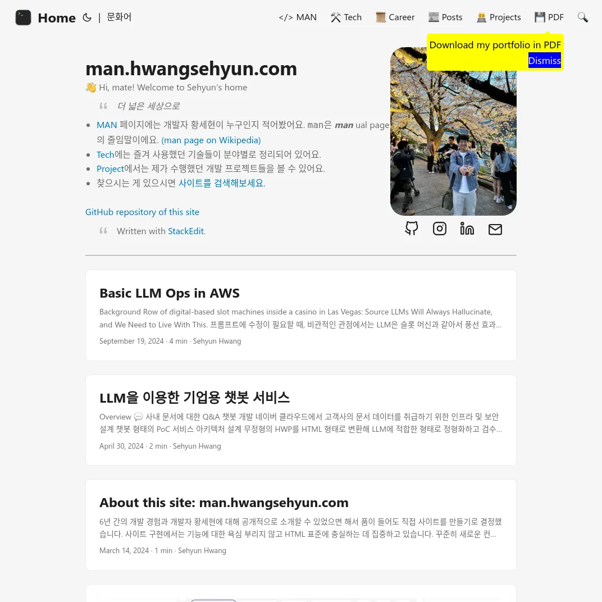

# [man.hwangsehyun.com](https://man.hwangsehyun.com)



## Requirements

### Infrastructure

- [MicroCMS](https://microcms.io/en)
- [Cloudant CouchDB](https://www.ibm.com/products/cloudant) from IBM Cloud
- [StackEdit](https://stackedit.io/)
- [AWS Secrets Manager](https://aws.amazon.com/secrets-manager/) Secret
  - `HUGO_PARAMS_MICROCMS_KEY`
  - `CLOUDANT_APIKEY`

### Tools

- [Hugo](https://gohugo.io/) 0.170.0 or later, with image-processing support
- Node.js 26.13.1 LTS and pnpm 12.21.0, pinned in `package.json`
- Python 3.11 or later and Poetry 2 for the deployment helper
- Docker for the pinned Hugo toolchain image, Chrome/Chromium for screenshots and PDFs
- Existing globally managed `nextlab-eslint` and a CDK CLI compatible with the installed CDK library. CDK synthesis was validated with CLI 2.1148.1.

- NPM Libraries

  ```sh
  pnpm install --frozen-lockfile
  poetry install
  ```

The workspace retains a 24-hour minimum package release age. Lifecycle scripts are explicitly allowed for esbuild; legacy core-js and es5-ext install scripts are disabled. Older transitive dependencies from Paged.js remain until upstream releases replace them.

Build the pinned Hugo container with `make toolchain`. The image installs checksum-verified Hugo 0.170.0 over a digest-pinned base image. Browser targets use the workspace's pinned Puppeteer dependency and an installed Chrome/Chromium executable.

## Development

### Local

1. Sign in to AWS SSO using AWS CLI

  ```sh
  aws sso login
  ```

1. Download markdown contents from StackEdit

    ```sh
    make stackedit
    ```

1. Start Hugo

    ```sh
    git submodule update --init
    make server
    ```

1. Navigate to <http://localhost:1313>

## Validation

```sh
pnpm --filter @man-hwangsehyun-com/stackedit test
pnpm --filter @man-hwangsehyun-com/stackedit tsc
pnpm --filter @man-hwangsehyun-com/cdk exec tsc --noEmit
make build
node browser/print-pdf.js /all/ > /tmp/portfolio.pdf
```

`make build` and the server targets prepare compatible multilingual content before Hugo runs. Preparation preserves downloaded checksum files and writes normalized content to an ignored staging directory. Direct Hugo commands require `node src/hugo-content.js` first. Set `HUGO=/path/to/hugo` to select a non-default binary.

The PDF script uses local Chrome/Chromium headlessly and rejects missing source pages. Set `PUPPETEER_EXECUTABLE_PATH` to select a browser and `PUBLIC_DIR` to select another Hugo output directory. The `/all/` and `/kp/all/` routes contain printable portfolio pages. For local screenshots, pass the served site URL to `node browser/screenshot-index.js http://localhost:1313/` and redirect stdout to an image file.

Secret retrieval uses the AWS SDK credential provider chain, including the selected profile's regional SSO configuration. Sign in with `aws sso login --profile default` before retrieving secrets. Validation does not require deployment or Cloudant writes.

## Build & Deploy

1. Build site

    ```sh
    make build
    ```

1. Build screenshot and pdf

    ```sh
    make browser -B
    ```

1. Deploy to AWS

    ```sh
    make deploy
    ```
